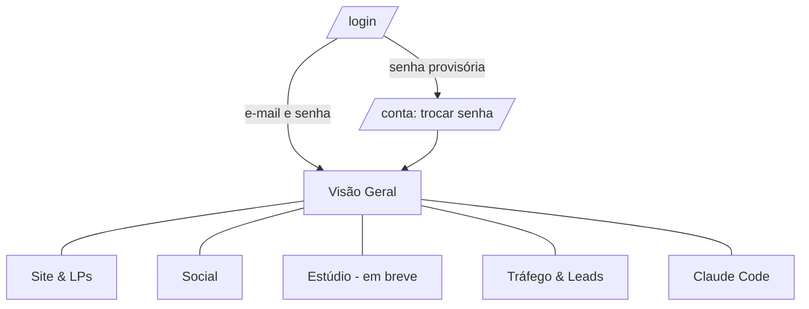
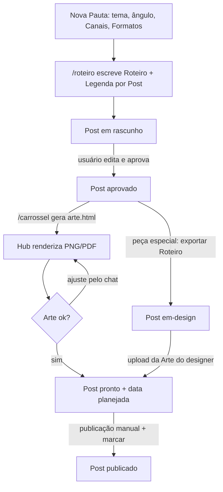
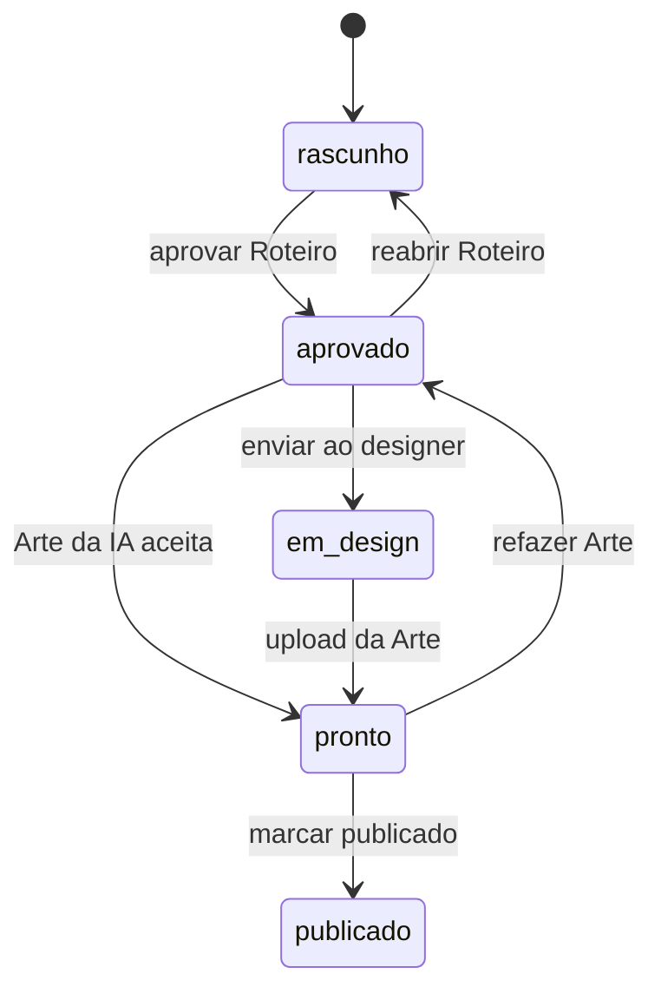
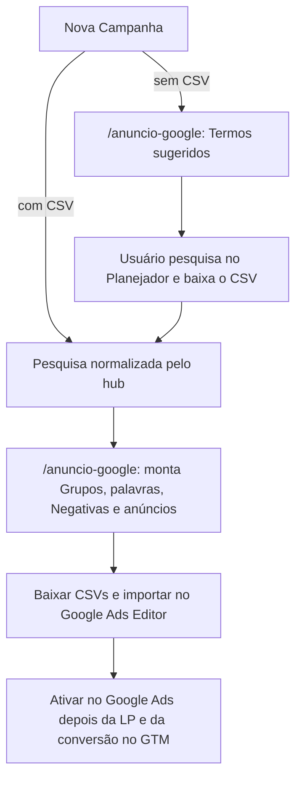

# App Flow — Stage Hub

Navegação e fluxos de cada Aba. Termos seguem o [GLOSSARY.md](../GLOSSARY.md).

## Navegação

Todas as Abas ficam na barra superior (`TopNav`), nesta ordem. Sem sessão válida, qualquer página redireciona para `/login`. Sem nenhum usuário cadastrado, `/login` vira "criar administrador". O menu da pessoa (canto direito do topo) leva a **Minha conta** (`/conta`) e, para administradores, **Usuários** (`/usuarios`).

| Aba | Rota | Estado |
|---|---|---|
| Visão Geral | `/` | Cards de status + chat |
| Site & LPs | `/site` | Landing Pages (lista + Nova LP) e site ao vivo (iframe, desktop/celular) |
| Social | `/social` | Quadro (arrastar muda Status), Nova Pauta, detalhe do Post, Calendário, Instagram, LinkedIn, Analytics (em breve) |
| Estúdio | `/estudio` | Em breve: biblioteca de Posts, edição de Artes, Templates, edição de vídeo |
| Tráfego & Leads | `/leads` | Campanhas Google Ads (lista + Nova Campanha); Leads e Relatórios aguardando |
| Claude Code | `/claude` | Explorador de arquivos + editor + chat |

## Social

### Telas

| Tela | Rota | Conteúdo |
|---|---|---|
| Quadro | `/social` | Colunas por Status; card do Post mostra capa, Canal, Formato, Série e data planejada. Botão **Nova Pauta** |
| Calendário | `/social/calendario` | ✅ Mês com os Posts pela data planejada (`?mes=AAAA-MM`), lista de Posts sem data |
| Detalhe do Post | `/social/<pauta>/<post>` | Roteiro e Legenda editáveis, preview da Arte no mock do feed, Status, data, exportar, upload, chat de ajuste, excluir Post ou Pauta |
| Instagram | `/social/instagram` | Feed real de @stage.consulting (12 posts mais recentes); post aberto ao lado; pré-visualização opcional dos Posts planejados |
| LinkedIn | `/social/linkedin` | Página real da Stage (logo, slogan, seguidores, funcionários, descrição) e os 10 posts recentes (tipo, data, curtidas, link); ao lado, Posts de LinkedIn planejados no hub |
| Editor de Arte | `/social/<pauta>/<post>/editor` | Slides à esquerda, canvas no centro, propriedades à direita; salvar re-renderiza e volta ao Post |
| Nova Pauta | modal sobre o Quadro | Tema, ângulo, Canais e Formatos; ou "Sugerir Pautas" |

### Fluxo principal

### Status

## Claude Code

Árvore de arquivos do workspace à esquerda, editor Monaco ao centro, chat com o Claude à direita. Arquivos `.git`, `node_modules` e `.next` ficam ocultos.

## Tráfego & Leads

| Tela | Rota | Conteúdo |
|---|---|---|
| Tráfego & Leads | `/leads` | Lista de Campanhas, botão Nova Campanha, cards das próximas etapas (Leads, Relatórios); as LPs ficam em Site & LPs |
| Nova Campanha | modal | Nome, serviço, orçamento, região, briefing e CSV do Planejador (opcional) |
| Campanha | `/leads/campanhas/<slug>` | Etapas (Termos sugeridos → Pesquisa → Campanha montada), Grupos com palavras-chave e preview do anúncio no Google, Negativas, downloads para o Ads Editor, URL da LP, Status, Estratégia e tabela da Pesquisa |

| Tela | Rota | Conteúdo |
|---|---|---|
## Site & LPs

| Tela | Rota | Conteúdo |
|---|---|---|
| Site & LPs | `/site` | Cards das LPs (Finalidade, Status, gerada ou não), botão Nova LP, site ao vivo |
| Nova LP | modal em `/site` | Finalidade ("vai para uma campanha de tráfego pago?": Campanha de Ads ou Página do site), Campanha (só em Ads, opcional), nome (vira o endereço), serviço, briefing |
| Landing Page | `/site/lp/<slug>` | Preview desktop/celular em iframe isolado, Finalidade e Campanha atrelada (trocáveis), pedir ajuste à IA, gerar do zero, Status, baixar HTML, URL publicada |

Previsto: publicar direto no servidor de hospedagem do site ao aprovar, editor de página (como o Editor de Arte) e painel de SEO.
