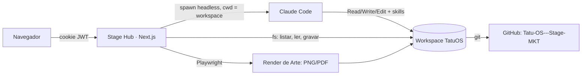

# TRD — Stage Hub

Documento de requisitos técnicos. O **porquê** de cada decisão está nas [ADRs](adr/); aqui fica o **como**.

## Stack

| Camada | Escolha |
|---|---|
| Framework | Next.js 16 (App Router) + React 19 + TypeScript |
| Estilo | Tailwind CSS 4, tokens em `src/app/globals.css` ([Design System](DESIGN-SYSTEM.md)) |
| Auth | Senha única + cookie JWT (`jose`), validado em `src/proxy.ts` |
| IA | Claude Code headless (`claude -p --output-format stream-json`) — [ADR 0001](adr/0001-claude-code-headless-no-workspace.md) |
| Dados | Arquivos Markdown no workspace TatuOS — [ADR 0005](adr/0005-posts-como-arquivos-no-workspace.md) |
| Render de Arte | Playwright + Chromium no servidor do hub (`src/lib/render.ts`) — [ADR 0007](adr/0007-arte-gerada-pela-ia-no-mvp.md) |
| Editor de código | Monaco (`@monaco-editor/react`) na aba Claude Code |
| Deploy | Hoje local (`npm run dev`, porta 3100). Futuro: VPS com Docker — [ADR 0003](adr/0003-stack-nextjs-vps.md) |

## Arquitetura

- O hub e o workspace são repositórios separados ([ADR 0002](adr/0002-workspace-separado-do-hub.md)); o hub chega ao workspace por `WORKSPACE_DIR`.
- Todo acesso a arquivo passa por `resolveSafe()` em `src/lib/workspace.ts`, que impede sair do workspace.

## Claude no hub

- Ferramentas liberadas: Read, Edit, Write, Glob, Grep, WebSearch, WebFetch, Skill, TodoWrite.
- Bloqueadas: Bash, PowerShell e ferramentas de Artifact. O hub nunca roda comando pelo Claude; tarefas que precisam de processo (render) são feitas pelo próprio servidor do hub.
- Permissão `acceptEdits`; conversas continuam com `--resume <session_id>`.
- Autenticação: login local do Claude Code. **Antes de abrir para o time, definir `ANTHROPIC_API_KEY`** (cobrança pela API).

## Configuração (`.env.local`)

| Variável | Uso |
|---|---|
| `HUB_PASSWORD` | Senha de acesso |
| `HUB_SECRET` | Assinatura do cookie (32+ caracteres) |
| `WORKSPACE_DIR` | Caminho do workspace TatuOS |
| `SITE_URL` | Site monitorado na Visão Geral |
| `CLAUDE_BIN` | Opcional: caminho do Claude Code |
| `ANTHROPIC_API_KEY` | Futuro: cobrança pela API |

## Módulo Social — requisitos técnicos

- **Índice sem banco:** o hub monta Quadro e Calendário lendo o frontmatter de `post.md` em `marketing/social/*/*/` ([Backend](BACKEND.md)), via `src/lib/social.ts` e `src/lib/frontmatter.ts`.
- **Skill `/roteiro`** (TatuOS): recebe a Pauta e grava `pauta.md`, `post.md` e `legenda.md`.
- **Skill `/carrossel` — Modo Hub** (TatuOS): lê o Roteiro, a Série e a Biblioteca de assets e grava só `arte/arte.html`.
- **Render no servidor** (`src/lib/render.ts`): Chromium headless compartilhado, fila de um render por vez, `slide-NN.png` por `.slide` e `arte.pdf` no carrossel do LinkedIn; a Arte anterior vai para `arte/historico/`.
- **Ajuste:** `POST .../arte { ajuste }` pede à `/carrossel` para editar o `arte.html` existente e re-renderiza.
- **Editor de Arte** ([ADR 0008](adr/0008-editor-de-arte-sobre-o-html.md)): `src/components/social/ArteEditor.tsx` carrega o `arte.html` por `/api/ws/...` num iframe da mesma origem e edita o DOM (estilos inline; mover = `translate`). Desfazer/refazer por fotografia do `<body>`. Salvar envia o HTML para `PUT .../arte/html` (`salvarArteHtml` em `render.ts`) e re-renderiza.
- **Upload:** a Arte do designer é gravada em `arte/` e marca `origem_arte: designer`.
- **Perfis dos Canais:** Instagram lido com o Chromium do render ([ADR 0010](adr/0010-feed-instagram-pelo-perfil-publico.md), `src/lib/instagram.ts`); LinkedIn lido com `fetch` simples do JSON-LD da página pública ([ADR 0011](adr/0011-linkedin-pela-pagina-publica.md), `src/lib/linkedin.ts`). Cópias em `marketing/social/_perfis/<canal>/`, atualizadas por botão e uma vez por dia.
- **Frontmatter escrito pela IA:** a `/roteiro` põe `titulo` e `angulo` entre aspas; texto com `:` sem aspas quebra o YAML e o Post aparece como "fora do padrão" no Quadro.
- **Docker:** a imagem da VPS precisa incluir Chromium (`npx playwright install --with-deps chromium`); `playwright` fica em `serverExternalPackages`.

## Módulo Tráfego & Leads — requisitos técnicos

- **Campanhas em arquivos** (`src/lib/ads.ts`): `marketing/ads/campanhas/<data>-<slug>/` com `campanha.md`, `pesquisa/` e `ads-editor/`.
- **Leitura do Planejador** (`src/lib/csv.ts`): decodifica UTF-16 (BOM ou não) e UTF-8, detecta separador, acha o cabeçalho em PT ou EN depois das linhas de título, converte faixas ("1 mil – 10 mil") e lances em reais; aceita também lista simples.
- **Skill `/anuncio-google` — Modo Hub** (TatuOS): Tarefa A grava `pesquisa/sementes.md`; Tarefa B grava os CSVs de `ads-editor/` com cabeçalhos fixos, que o hub lê pelo nome da coluna.
- **Landing Pages** (`src/lib/lp.ts`): `marketing/landing-pages/<slug>/` com `lp.md`, cópia do logo e `index.html` gerado pela skill `/landing-page`. Download e preview entregam o HTML com o logo em data URI (arquivo único). A `finalidade` do `lp.md` ([ADR 0012](adr/0012-finalidade-da-lp.md)) muda o que a skill gera: LP de Ads (`noindex`, promessa da Campanha) ou Página do site (matéria indexável, formulário no fim). As telas das LPs ficam em `/site`.
- **Leads (pendente):** destino depende do levantamento T0; o formulário da LP já envia JSON para `data-endpoint` quando ele existir.
- **Streams no navegador:** `src/lib/stream-client.ts` lê o NDJSON de `ChatEvent` de qualquer rota que chama o Claude.

## Segurança

- Rotas protegidas por `src/proxy.ts`; só `/login`, `/api/login` e `/api/login/setup` são públicas. O proxy confere a sessão contra o cadastro a cada requisição (usuário ativo, sessão emitida depois da última troca de senha), segura quem tem senha provisória em `/conta` e libera `/usuarios` só para administradores ([ADR 0009](adr/0009-usuarios-em-arquivo-no-hub.md)).
- Senhas em hash scrypt com sal; login responde igual para e-mail inexistente e senha errada. O primeiro administrador só pode ser criado com a `HUB_PASSWORD` e enquanto não existe nenhum usuário.
- Slugs de URL validados por regex antes de virar caminho; todo acesso a arquivo passa por `resolveSafe()`; rotas de arquivo recusam `..` e só servem extensões e pastas permitidas.
- Upload de Arte aceita só PNG, JPG e PDF (20 MB); upload de Pesquisa só CSV/TSV/TXT (10 MB).
- O HTML da Arte é renderizado só com arquivos do workspace e Google Fonts (demais requisições abortadas).
- No Editor de Arte o HTML abre com `Content-Security-Policy: script-src 'none'; connect-src 'none'` (nenhum script da IA roda; o hub edita o DOM de fora). Ao salvar, `limparHtmlArte()` remove `<script>`, atributos `on*`, `javascript:` e marcas do editor.
- O preview da LP (HTML escrito pela IA) roda em iframe `sandbox="allow-scripts allow-forms"` e com `Content-Security-Policy: sandbox …; connect-src 'none'; form-action 'none'`: origem opaca, sem cookies nem API do hub.
